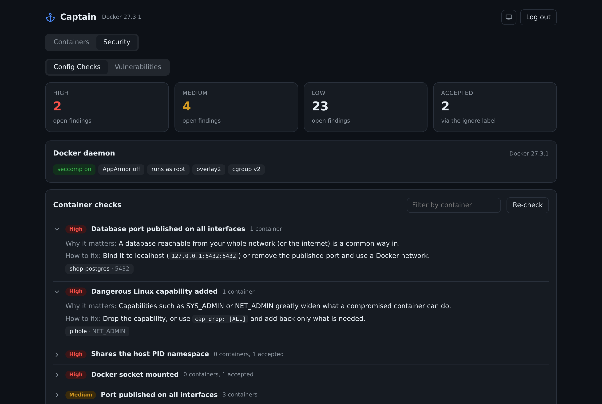
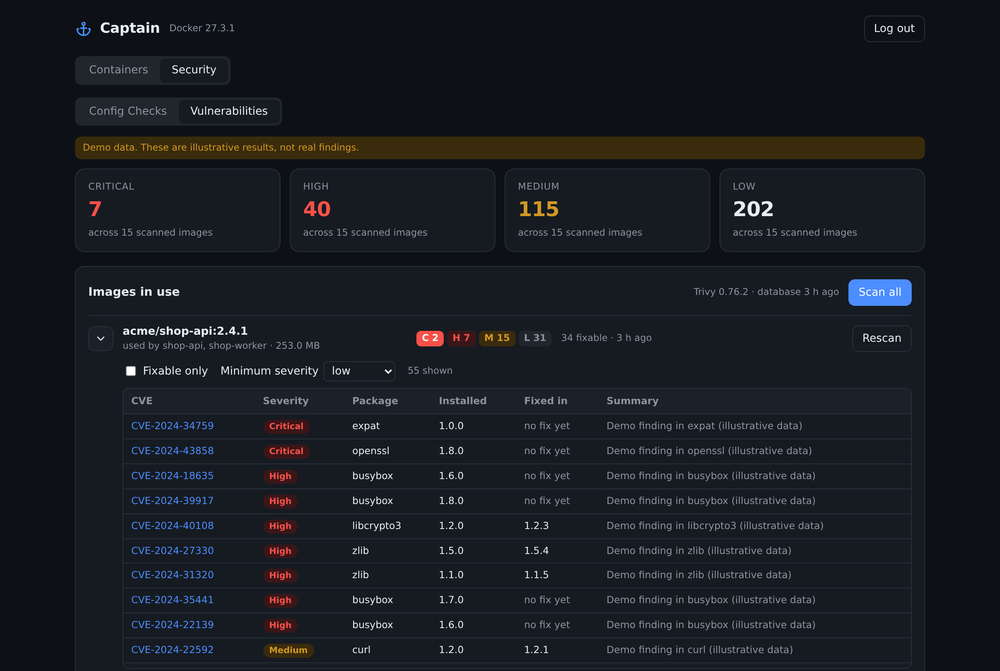
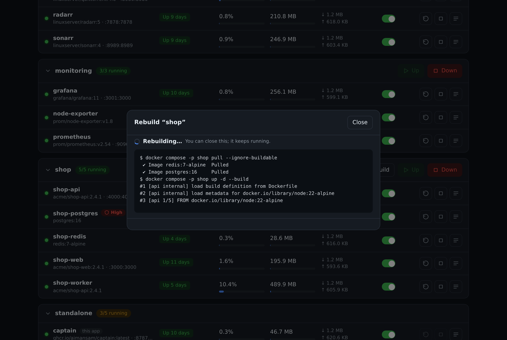
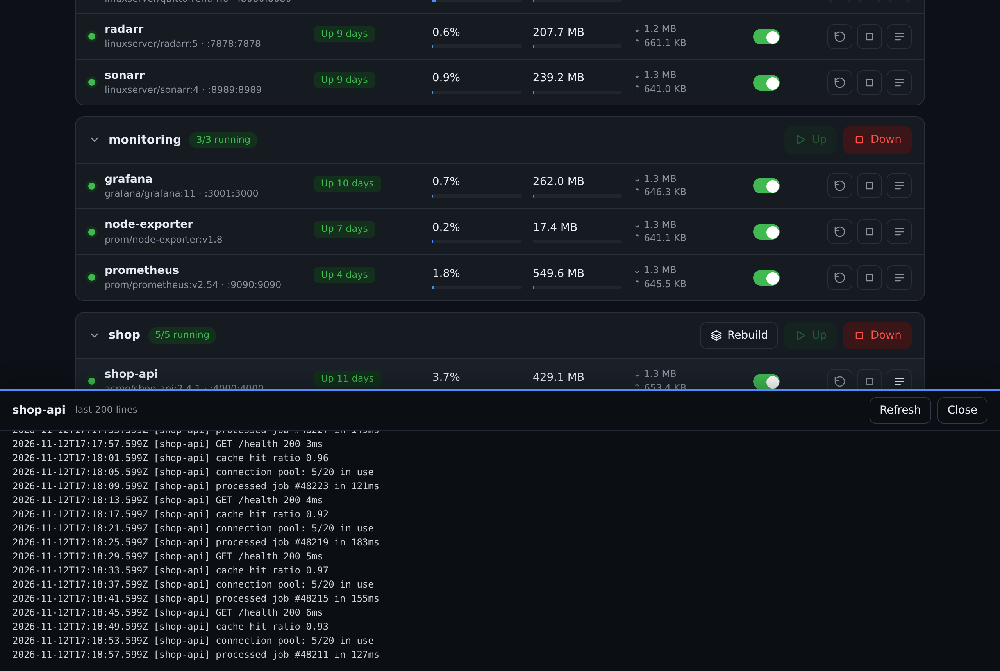

<div align="center">

# ⚓ Captain

**Secure your Docker containers: audit risky settings, scan images for vulnerabilities, and manage everything from one small dashboard.**

Captain shows which of your containers are misconfigured or exposed and which images carry known vulnerabilities, then lets you fix things from the same page: start, stop, rebuild, switch auto-start, and clean up with a preview of exactly what will be removed.

[](https://github.com/aimansam/captain/actions/workflows/ci.yml)
[](https://github.com/aimansam/captain/releases)
[](LICENSE)


</div>

## Quick start

```bash
docker run -d --name captain --restart unless-stopped \
  -p 8787:8787 \
  -e ADMIN_PASSWORD='pick-a-long-password' \
  -v /var/run/docker.sock:/var/run/docker.sock \
  -v captain-data:/data \
  ghcr.io/aimansam/captain:latest
```

Open <http://localhost:8787> and sign in. Works on amd64 and arm64 (Raspberry Pi included).

Want to look around first? Run it with fake data, no Docker access needed:

```bash
docker run --rm -p 8787:8787 -e DEMO=true ghcr.io/aimansam/captain:latest   # password: demo
```

<details>
<summary>Docker Compose</summary>

```yaml
services:
  captain:
    image: ghcr.io/aimansam/captain:latest
    container_name: captain
    restart: unless-stopped
    ports:
      - "8787:8787"
    environment:
      ADMIN_PASSWORD: ${ADMIN_PASSWORD:?set a password}
    volumes:
      - /var/run/docker.sock:/var/run/docker.sock
      - captain-data:/data          # vulnerability database and scan results (optional)

volumes:
  captain-data:
```
</details>

## Features

- **Security checks**: reviews every container's configuration (privileged, Docker socket mounted, host network, database ports open to the network, root user, no limits...) and the Docker daemon, with a fix hint for each finding. Containers with a high or medium finding get a badge right on the dashboard. See [Security checks](#security-checks).
- **Vulnerability scan**: scans the images your containers actually use for known CVEs with [Trivy](https://github.com/aquasecurity/trivy), filter by severity or "fixable only", and link out to each CVE.
- **Live overview**: running count, CPU, memory and disk usage, plus per-container CPU, RAM and network, refreshed every 3 seconds.
- **One-click control**: start, stop and restart any container. Stopping Captain itself is blocked.
- **Compose projects**: containers are grouped by project, with a single **Up** and **Down** button per project. Down only stops containers; nothing is removed.
- **Rebuild a project**: one click runs `docker compose up -d --build` with live output, optionally pulling newer images first. Containers whose image or settings changed are recreated; volumes are kept. See [Enabling Rebuild](#enabling-rebuild).
- **Auto-start switch**: choose per container whether it comes back after a reboot or Docker restart (`unless-stopped` vs `no`).
- **Cleanup with a preview**: see stopped containers, dangling images, build cache, unused networks and unused volumes, then tick exactly what to remove. Containers stopped 7+ days are pre-selected, and **volumes are never pre-selected**, because deleting one destroys its data. Running containers and in-use volumes are refused.
- **Logs**: tail the last 200 lines of any container.
- **Search and filter** by name, image or project, and light and dark themes.
- **Light**: one small container, no database, no agent.

| Security checks | Vulnerability scan |
|---|---|
|  |  |
| **Dashboard** | **Cleanup preview** |
|  |  |
| **Rebuild with live output** | **Logs** |
|  |  |

## Where it fits

Plenty of good Docker tools exist. Captain aims at a specific gap: seeing and fixing container security issues without leaving a small, day-to-day dashboard.

| Tool | Best for |
|---|---|
| **Captain** | Finding risky container settings and vulnerable images, then fixing and managing containers from one small dashboard. |
| Trivy | The scanner Captain uses for image CVEs. Use it directly for CI pipelines and deeper scanning (secrets, IaC). |
| Docker Bench for Security | A full CIS Docker Benchmark audit of the host. Captain's checks are a smaller, practical subset. |
| Portainer | Full container platform: stacks, registries, users, teams, Kubernetes. |
| Dockge | Editing and managing compose stacks and their files. |
| Dozzle | Real-time log viewing. |

## Security checks

The **Security** tab has two parts. They help you find and fix problems; they don't guarantee a setup is secure, and the config checks are a practical set rather than the full CIS Docker Benchmark.

**Config checks** read each container's settings (nothing is scanned or installed) and group findings by severity:

| Severity | Checks |
|---|---|
| High | privileged; host PID/IPC namespace; Docker socket mounted; writable mount of a system path (`/etc`, `/root`...); dangerous capabilities (`SYS_ADMIN`, `NET_ADMIN`...); a database port published on all interfaces |
| Medium | host network; seccomp/AppArmor disabled; any other port published on all interfaces |
| Low | runs as root; no memory limit; no healthcheck; image not pinned (`latest` or untagged) |

It also checks the Docker daemon (for example, whether seccomp is active). If a finding is intentional, mark it as accepted with a label. It stays visible but stops counting:

```yaml
services:
  traefik:
    labels:
      captain.security.ignore: "docker-sock,root-user"
```

Captain's own Docker socket mount is accepted automatically. Containers with a high or medium finding get a small badge on the main dashboard.

**Vulnerabilities** scans the images in use with Trivy. Press **Scan all** or scan one image, then expand it to see each CVE, its package, the fixed version and a link to details. Things to know:

- Mount a volume at `/data` (as in the examples above) so the vulnerability database and results survive restarts. Without it everything still works, but the database is downloaded again after each restart.
- The first scan downloads Trivy's database: about 80 MB to download, **about 1.6 GB on disk**. Nothing is downloaded until you scan.
- Trivy adds about 50 MB to the image download (about 170 MB on disk).
- Scans only read your images; they never change anything, so they still work in `READ_ONLY` mode.
- Behind a firewall or offline, point `TRIVY_DB_REPOSITORY` at a mirror. Set `SCAN_INTERVAL_HOURS` to rescan automatically.

## Enabling Rebuild

Rebuild needs the compose files, which live on your host, not in Docker. Mount the folders that hold your compose projects **read-only, at the same path as on the host**:

```yaml
services:
  captain:
    image: ghcr.io/aimansam/captain:latest
    volumes:
      - /var/run/docker.sock:/var/run/docker.sock
      - /srv/stacks:/srv/stacks:ro        # same path inside and outside
```

Captain reads each project's location from its compose labels and shows a **Rebuild** button only when the files are reachable. Notes:

- It runs `docker compose -p <project> up -d --build` (plus `pull` if you tick the box), with Captain's own secrets kept out of the process environment.
- Captain can't rebuild its own project (it would stop itself). Run `docker compose up -d --build` on the host for that.
- Rebuild runs the build steps in your compose files, so only mount folders you trust. It's disabled in `READ_ONLY` mode.
- The image includes the Docker CLI, Compose and Buildx for this feature, which makes it larger than a bare Node image.

## Configuration

| Variable | Default | Description |
|---|---|---|
| `ADMIN_PASSWORD` | required | Login password, at least 8 characters. |
| `SESSION_SECRET` | random | Keeps sessions valid across restarts. Generate with `openssl rand -hex 32`. |
| `PORT` | `8787` | Port inside the container. |
| `SECURE_COOKIE` | `false` | Set `true` when served over HTTPS. |
| `READ_ONLY` | `false` | View-only mode: every action and cleanup is disabled. |
| `SCAN_INTERVAL_HOURS` | `0` | Rescan images automatically every N hours (`0` = only when you press Scan). |
| `TRIVY_DB_REPOSITORY` | Trivy default | Mirror for the vulnerability database, e.g. `public.ecr.aws/aquasecurity/trivy-db`. |
| `DEMO` | `false` | Serve fake data instead of talking to Docker. |

## Securing Captain itself

Captain mounts the Docker socket. **Anyone who can sign in can control every container on the host**, which is effectively root. Please:

- Use a long, unique password. Failed logins are rate limited (5 per 15 minutes per address).
- Don't expose it directly to the internet. Keep it on your LAN, behind a VPN, or behind a reverse proxy or tunnel with its own authentication, and set `SECURE_COOKIE=true` when using HTTPS.
- Use `READ_ONLY=true` if you only want to look.

Captain has no endpoint for running arbitrary commands or creating containers. What it runs is `docker compose up` for a project's own compose files when you press Rebuild, and Trivy to read your images when you press Scan. See [SECURITY.md](SECURITY.md) to report a vulnerability.

## Development

```bash
# backend
cd server && npm install && DEMO=true ADMIN_PASSWORD=demo npm start     # http://localhost:8787
# frontend (hot reload, proxies /api to :8787)
cd web && npm install && npm run dev
# tests
cd server && npm test
```

Regenerate the screenshots and demo GIF with `scripts/screenshots.py` (see the file header).

## Roadmap

- Crash and unexpected-stop alerts with an event timeline
- Locked containers that refuse stop, restart and cleanup
- CPU and memory history charts
- Healthcheck and restart-loop indicators
- Per-container image update checks
- Wider coverage of the CIS Docker Benchmark

Ideas and pull requests are welcome, see [CONTRIBUTING.md](CONTRIBUTING.md).

## License

[MIT](LICENSE)
