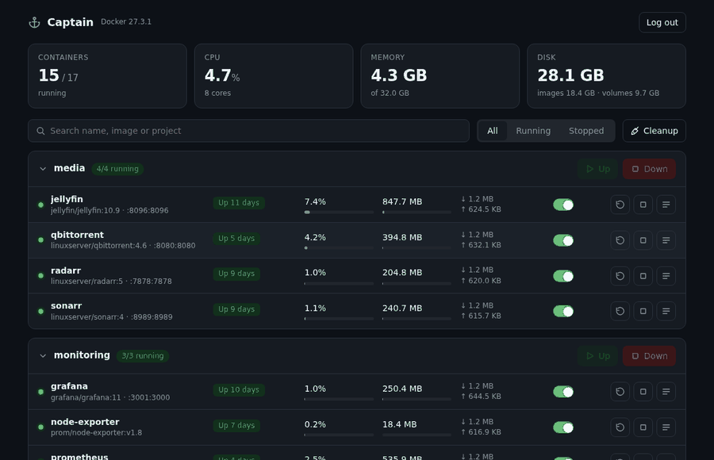
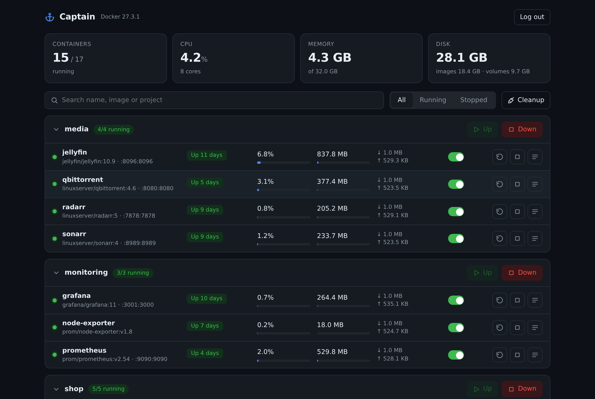
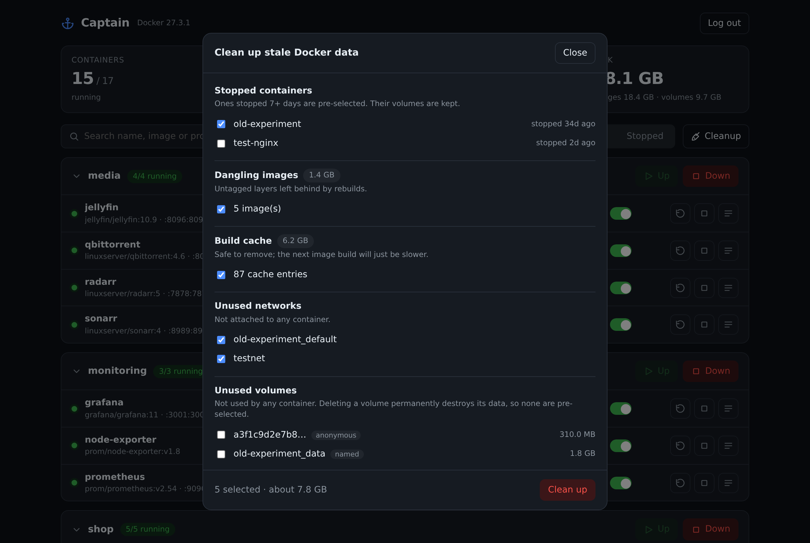

<div align="center">

# ⚓ Captain

**A tiny Docker dashboard that shows what's stale before you clean it.**

Start, stop and restart containers, bring whole compose projects up and down, flip auto-start on reboot, and reclaim disk space, with a preview of exactly what will be removed.

[](https://github.com/aimansam/captain/actions/workflows/ci.yml)
[](https://github.com/aimansam/captain/releases)
[](LICENSE)



</div>

## Quick start

```bash
docker run -d --name captain --restart unless-stopped \
  -p 8787:8787 \
  -e ADMIN_PASSWORD='pick-a-long-password' \
  -v /var/run/docker.sock:/var/run/docker.sock \
  ghcr.io/aimansam/captain:latest
```

Open <http://localhost:8787> and sign in. Works on amd64 and arm64 (Raspberry Pi included).

Want to look around first? Run it with fake data, no Docker access needed:

```bash
docker run --rm -p 8787:8787 -e DEMO=true ghcr.io/aimansam/captain:latest   # password: demo
```

<details>
<summary>Docker Compose</summary>

```yaml
services:
  captain:
    image: ghcr.io/aimansam/captain:latest
    container_name: captain
    restart: unless-stopped
    ports:
      - "8787:8787"
    environment:
      ADMIN_PASSWORD: ${ADMIN_PASSWORD:?set a password}
    volumes:
      - /var/run/docker.sock:/var/run/docker.sock
```
</details>

## Features

- **Live overview**: running count, CPU, memory and disk usage, plus per-container CPU, RAM and network, refreshed every 3 seconds.
- **One-click control**: start, stop and restart any container. Stopping Captain itself is blocked.
- **Compose projects**: containers are grouped by project, with a single **Up** and **Down** button per project. Down only stops containers; nothing is removed.
- **Auto-start switch**: choose per container whether it comes back after a reboot or Docker restart (`unless-stopped` vs `no`).
- **Cleanup with a preview**: see stopped containers, dangling images, build cache, unused networks and unused volumes, then tick exactly what to remove. Containers stopped 7+ days are pre-selected, and **volumes are never pre-selected**, because deleting one destroys its data. Running containers and in-use volumes are refused.
- **Logs**: tail the last 200 lines of any container.
- **Search and filter** by name, image or project, and light and dark themes.
- **Light**: one small container, no database, no agent.

| Dashboard | Cleanup preview |
|---|---|
|  |  |

## Where it fits

Plenty of good Docker tools exist. Captain aims at a specific gap.

| Tool | Best for |
|---|---|
| **Captain** | A small, single-purpose dashboard: quick start/stop, project up/down, and cleanup you can review before anything is deleted. |
| Portainer | Full container platform: stacks, registries, users, teams, Kubernetes. |
| Dockge | Editing and managing compose stacks and their files. |
| Dozzle | Real-time log viewing. |

## Configuration

| Variable | Default | Description |
|---|---|---|
| `ADMIN_PASSWORD` | required | Login password, at least 8 characters. |
| `SESSION_SECRET` | random | Keeps sessions valid across restarts. Generate with `openssl rand -hex 32`. |
| `PORT` | `8787` | Port inside the container. |
| `SECURE_COOKIE` | `false` | Set `true` when served over HTTPS. |
| `READ_ONLY` | `false` | View-only mode: every action and cleanup is disabled. |
| `DEMO` | `false` | Serve fake data instead of talking to Docker. |

## Security

Captain mounts the Docker socket. **Anyone who can sign in can control every container on the host**, which is effectively root. Please:

- Use a long, unique password. Failed logins are rate limited (5 per 15 minutes per address).
- Don't expose it directly to the internet. Keep it on your LAN, behind a VPN, or behind a reverse proxy or tunnel with its own authentication, and set `SECURE_COOKIE=true` when using HTTPS.
- Use `READ_ONLY=true` if you only want to look.

Captain has no endpoints for running commands, pulling images or creating containers. See [SECURITY.md](SECURITY.md) to report a vulnerability.

## Development

```bash
# backend
cd server && npm install && DEMO=true ADMIN_PASSWORD=demo npm start     # http://localhost:8787
# frontend (hot reload, proxies /api to :8787)
cd web && npm install && npm run dev
# tests
cd server && npm test
```

Regenerate the screenshots and demo GIF with `scripts/screenshots.py` (see the file header).

## Roadmap

- Crash and unexpected-stop alerts with an event timeline
- CPU and memory history charts
- Healthcheck and restart-loop indicators
- Image update checks

Ideas and pull requests are welcome, see [CONTRIBUTING.md](CONTRIBUTING.md).

## License

[MIT](LICENSE)
